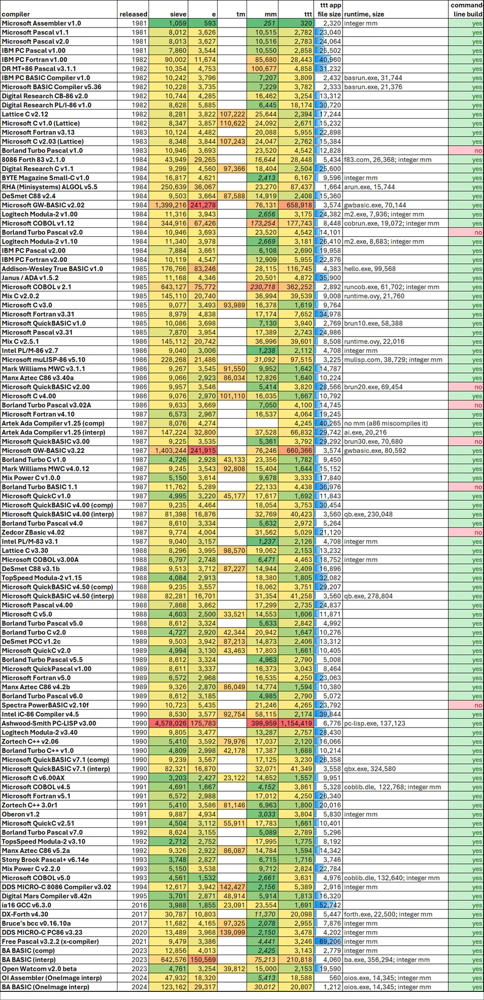

# dos_compilers
MS-DOS compilers, assemblers, and interpreters

The license for this repo applies to code I wrote for this repo including versions of the sieve, e, ttt, tm, and mm benchmarks and the build scripts to invoke the tools. The various DOS tools and documentation each have their own respective license terms. In a few cases I used the sieve benchmark that shipped with the tools, so obviously those copies fall under the license of the respective tool.

I do not own the copyright for any of these tools. This repo is simply an aggregation of the tools to ease testing of my NTVDM DOS 3.3 emulator.

In some cases where required I've copied an assembler or linker that did not ship with a given compiler into folders so binaries can be produced. These tools belong to their respective owners.

These tools are available for download from many sites on the internet. They are often in forms that make their extraction and/or use difficult. This repo simplifies the process.

**If you own the copyright to any of these tools and want me to take them down, please let me know and I'll do so ASAP. It's not my intention to pirate anyone's software.**

I can't vouch that any of these tools match their official distribution form. Many of these were apparently taken from snapshots on peoples' machines through the years and include changes, files, and/or configuration not found in a pristine distribution. 

In some cases I've included user manuals in PDF form that I've found online for the various compilers. They sometimes match the version and sometimes not, but they are always helpful.

I can vouch that the m.bat/m.sh script in each folder builds working benchmark binaries using NTVDM on Windows, Linux, and MacOS. In the cases of tools that can't be invoked via the command-line, those tools also produce working benchmark binaries in NTVDM.

It is my intention to show each tool in its best light with respect to the benchmarks. If you know of better optimization flags or ways to improve the benchmark source code for a given tool, please feel free to submit a pull request or open an issue. That said, I want to avoid cheap hacks like using peek/poke in BASIC instead of variables.

The benchmarks include:
  * sieve: The classic from BYTE Magazine that counts prime numbers. Measures array and loop performance.
  * e: Computes the irrational number e to 192 digits. Measures integer multiply/divide along with array and loop performance.
  * ttt: proves you can't win at tic-tac-toe if the opponent is competent. Measures function call and stack access along with array and loop performance.
  * tm: test malloc. This calls malloc/calloc/free in the C runtime to measure performance. It's C-only and many C compilers can't run it.
  * mm: matrix multiply. Jerry Pournelle's benchmark from the October 1982 BYTE Magazine multiplies two 20x20 matrices and sums the result. Measures floating point math and two-dimensional array indexing. A and B hold small whole numbers, so every floating point format computes the sum 465880 exactly (RHA ALGOL's 3-byte mantissa gets 465879.8). Tools without floating point, or whose floating point can't run under NTVDM, run the same arithmetic with integers; the table's notes column says "integer mm" for those, and their times aren't comparable to the floating point ones.

The original BYTE listings of mm in BASIC and Pascal both have bugs, and not the same ones, that go unnoticed only because the benchmark's matrices are square. Both declare A as m x n, B as n x m, and C as m x m. In both, the multiply loop runs j to n and k to m when it should run j to m and k to n. The BASIC listing also fills B with the row and column bounds swapped, and fills and sums C with columns running to n instead of m; the Pascal listing gets those right. The code only works when all the dimensions are the same, like 20x20. The mm sources in this repo have those bugs fixed.

NTVDM doesn't emulate an 8087, so the floating point times are for software floating point, as on a PC without one: runtimes that check for an 8087 find none and use their emulators. A few tools' floating point needs a real 8087, so their mm is integer: Logitech Modula-2 v1.0 and v1.1 (even x := 5.0; x = 5.0 is false), Intel PL/M-86, and Free Pascal v3.2.2 (its i8086-msdos target has no 8087 emulator). Bruce's bcc has no floating point support for DOS, and BA BASIC and OneImage have only integers, so their mm is integer too. Artek Ada's native code (the comp row) has no mm time: its a86 translator produces wrong code for every variation of the program tried, though the interpreter runs it correctly.

To run the compilers on Windows, use the m.bat script in each folder. Sometimes m.bat is in a subfolder named "bin" or "code". On Linux or MacOS use m.sh. You may need to "chmod 777 m.sh" before you can invoke it. For example (on Windows):
  * m sieve
  * m e
  * m ttt
  * m mm
    
To run the resulting apps, use NTVDM's -c flag to force console mode and -p flag to show performance information. The interpreters have other modes for running; see their respective m.bat/m.sh files for details.

  * ntvdm -c -p sieve
  * ntvdm -c -p e
  * ntvdm -c -p ttt
  * ntvdm -c -p mm
    
The Borland Turbo Pascal v1 through v3 scripts use TURBOCL.COM for command-line builds. To regenerate it from the bundled TURBO.COM, run build_turbocl.py with Python 3 and GNU binutils with i386 support. The QuickBASIC 2.x and 3.00 scripts use the original QB.EXE separate-compilation mode and LINK.EXE. The QB.EXE in the v200 folder reports version 2.01. The ZBasic 4.02 scripts use ZBASICCL.COM, which can be regenerated from ZBASIC.COM with build_zbasiccl.py and the same tools. The Turbo BASIC 1.1 and PowerBASIC 2.10f scripts use TBCL.EXE and PBCL.EXE, respectively. Run build_basiccl.py in either folder to regenerate its executable with the same tools.

The Microsoft COBOL benchmarks use an explicit stack for ttt, including v1.12 and v2.1, which do not support recursive PERFORM. All sieve versions run ten passes over 8,190 flags; v1.12 and v2.1 use two 4,095-byte windows. The e benchmarks generate 192 digits in blocks, using packed decimal in the older versions and native binary arithmetic in v3.00A, v4.5, and v5.0. Native-code ttt versions retain ten iterations; the table reports the time for one iteration.

The Lisp benchmarks use storage suited to each interpreter: native arrays and hunks in PC-LISP, and list-tail traversal with native LOOP control in muLISP. Sieve runs ten passes over 8,190 odd candidates; e uses integer digit blocks while retaining the original 200-cell factorial spigot. The timings include interpreter startup and, for muLISP, loading COMMON.LSP and STRUCTUR.LSP. The muLISP ttt runs ten repetitions, with the table reporting the time for one.

The BA compiler is in the [tic-tac-toe and its applicability to nuclear war](https://github.com/davidly/ttt) repo. It generates code for 6502, 8080, 8086, 68000, x86, x64, arm32, arm64, and 64-bit RISC-V.

If you're running Linux or MacOS and see perplexing compilation errors, it could be your source files don't have cr/lf line separators. Use unix2dos to add them; some of these compilers require them. Some compilers require a ^Z / 0x1a at the end of files; CB86 is an example. Again, if you see build errors this may be the problem.

Here are runtimes for the benchmarks in milliseconds for a 4.77Mhz 8086 (not 8088) as emulated by [NTVDM](https://github.com/davidly/ntvdm)

